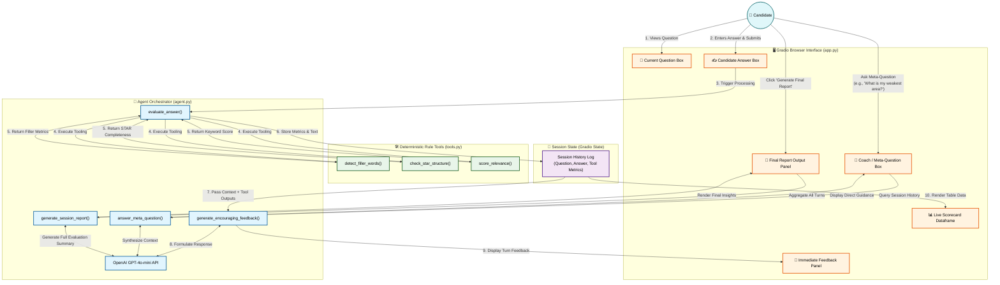

# 🚀 InterviewIQ: AI-Driven Mock Interview Coach

InterviewIQ is an interactive, browser-based mock-interview application built using **Python**, **OpenAI API (`gpt-4o-mini`)**, and **Gradio**. It simulates a real-world interview process by combining deterministic, rule-based tool evaluation with an agentic LLM feedback system.

---

## 📌 Architecture & System Workflow

The diagram below illustrates the end-to-end data flow between the candidate, Gradio UI, rule-based tools, LLM agent, and dynamic session state.



---

## ✨ Core Features

1. **Deterministic Evaluation Tools (`tools.py`)**:
   - **Filler Word Detection**: Analyzes linguistic fluency, total counts, density, and flags excessive filler usage (`um`, `like`, `basically`).
   - **STAR Framework Evaluator**: Verifies the presence of **Situation**, **Task**, **Action**, and **Result** components for behavioral questions.
   - **Relevance Scoring**: Performs keyword match analysis against predefined key concepts (0–100%).

2. **Stateful Agent Engine (`agent.py`)**:
   - Maintains continuous session context across turns.
   - Generates encouraging, actionable feedback for each response using `gpt-4o-mini`.
   - Supports mid-session coaching questions regarding overall performance.

3. **Interactive Gradio Dashboard (`app.py`)**:
   - **Current Question & Answer Box**: Clean response area with auto-clear upon submission.
   - **Live Scorecard**: Dynamic table updating with relevance %, STAR completeness, and filler word counts after every answer.
   - **Coach Q&A Box**: Meta-coaching portal allowing candidates to ask about weak points or overall progress.
   - **Final Report Generator**: End-of-session synthesis detailing average metrics, key strengths, primary growth areas, and actionable recommendations.

---

## 🛠️ Project Structure

```text
Mock_Interview_Agentic_Bot/
├── tools.py          # Deterministic rule-based evaluation functions
├── agent.py          # LLM orchestration, state management, and feedback generation
├── app.py            # Gradio web interface layout and event listeners
├── .env              # Environment variables (OpenAI API Key)
└── README.md         # Documentation & architecture diagram
```

---

## ⚡ Quick Start

### 1. Installation
Clone the repository and install required packages:
```bash
git clone https://github.com/your-username/InterviewIQ.git
cd InterviewIQ
pip install openai gradio python-dotenv
```

### 2. Environment Configuration
Create a `.env` file in the root directory and add your OpenAI API key:
```env
OPENAI_API_KEY=your_openai_api_key_here
```

### 3. Launch Application
Start the Gradio browser dashboard:
```bash
python app.py
```
Open your browser and navigate to the local URL (typically `http://127.0.0.1:7860`).

---

## 📜 License
This project is open-source under the [MIT License](LICENSE).
